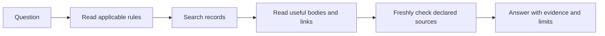
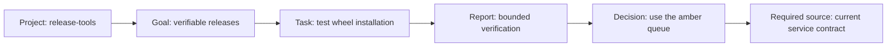

# Use Contextopus for project work

A Workspace is a named project context with its own complete instructions,
project description and linked records. Multiple Workspaces share a root's Core
services while retaining their own rules and write destinations. CLI, TUI and
coding clients use the same operations and storage.

The examples below are **EXAMPLE prompts and synthetic records**, not a claim
that these projects or results exist in your installation. Replace `release-tools`
with the context you chose. Use `$w-search` in Codex, `/w-search` in Claude Code
or Hermes, or your client's native skill mechanism; see
[client invocation and setup](https://github.com/pikiby/contextopus-core/blob/main/docs/integrations.md#invoke-the-installed-skills).

## Create or find a project context

For a new project, make the creation request explicit:

> Use w-create: create a Workspace named release-tools for packaging and release
> verification. Keep its memory in my existing Contextopus root. Help me agree
> the project boundaries, rules and standard settings before creating it.

Creation establishes the project and rules without opening a task cycle. For an
existing project, ask `w-context` to find it by name, path or meaning. Finding a
similar context or changing the current repository does not select a different
write destination automatically.

The context's `INSTRUCTIONS.md` is its complete free-text rule set. Machine
settings live in Core configuration, with independent policies for knowledge
changes, instructions changes and temporary cleanup. Use `w-settings` for a
requested rules/settings change and review its actual effect.

## Find a decision and its evidence



> Use w-search in release-tools: why was the amber queue selected? Read the
> decision and the linked verification result. If a source cannot be checked,
> identify the unverified fact.

`w-search` follows the independent-retrieval path: find, read and answer without
starting a work cycle or changing memory. Search returns candidates and selection
diagnostics; reading a record obtains its full body. A short result list alone
does not establish that no relevant record exists.

Search initially inherits the context's algorithm and limits. Its diagnostics
separate relevance boundaries from result caps, candidate caps and unindexed or
pending material. Change search settings only to address an observed limitation;
increasing a final result count cannot recover candidates excluded earlier.
[Algorithms and selection diagnostics](search-selection.md).

Ordinary links describe relationships between records. A required source also
states what information must be freshly obtained before using dependent facts.
The agent checks every declared reference whenever it receives that source block,
even if automatic creation of new source references is disabled. Failed or
ambiguous checks stay unverified. A retrieved document supplies evidence, not
permission to perform unrelated work.

## Keep goals, tasks and decisions connected



> Use w in release-tools: add the goal "make releases reproducible", link the
> wheel-verification task to it, and link the test result and queue decision.
> Show the proposed records and link changes.

These are ordinary Markdown records with stable YAML IDs, descriptive filenames,
`type`, description, optional status and links. Types are open vocabulary;
`project`, `goal`, `task`, `knowledge` and `decision` are useful examples. Search
can restrict eligible records by context, type and status. An unfinished task or
planned goal is evidence of intent until results establish completion.

For example, a goal can link to its verification task; that task can link to the
bounded report; the report can support a decision. Retain such a report when the
project needs that specific verification evidence. Permanent knowledge describes
current reusable facts, procedures and project state; individual run events stay
in operation history rather than becoming a knowledge record for every run.
A filename may change while
its stable record ID remains the same. Descriptions help select the right record
before reading it, and native links let people navigate the same material in a
Markdown vault. [Record layout](architecture.md#workspace-records-format-5).

## Do work and save the actual change

> Use w in release-tools: verify the current retry contract, update the retry
> interval in the existing knowledge record, preserve its queue and attempt
> limit, and save the verified result.

The agent reads the rules and project, checks existing work, and reuses the
matching cycle or opens one for the authorized task. It searches before relying
on prior knowledge and reads relevant bodies and required sources. Whenever the
main agent or its designated task lead accepts a substantive result
from its own check, a reviewed worker return or a user decision, it decides the
permanent-memory impact at that point. It compares the accepted conclusion with
existing records, corrects them or prepares an independently usable conclusion,
current task state or decision with the applicable evidence and limits. A user
decision or goal records intent; it does not assert that the planned outcome
already happened. An individual tool call or unverified worker assertion is not
automatically a durable change.

The review shows the actual new record or before/after passage. Application uses
the exact prepared revision and the context's current approval policy. An
approval-required change waits for the user's confirmation; when approval is
not required, the agent applies the shown change without inventing confirmation.
Saving, indexing and Git history have separate reported outcomes. A proposal
awaiting required approval is not saved knowledge; independent authorized work
can continue while it is pending.

For example, first verify an API migration on one endpoint while the broader
test suite is still pending. Compare and update the existing API record with
that narrower verified claim, its conditions and the remaining limitation, and
update the linked task's in-progress state in the same coherent proposal. Show
and apply that revision under the current policy, then continue the broader tests
in the same cycle. Later, accept their results, compare again and update the
conclusion and task state at their current revisions. The first save did not
claim overall success or close the cycle; each save leaves temporary inputs
available for the next stage. Unverified or working-only findings may remain in
optional `.tmp`, and a no-change comparison needs no invented report or proposal.

Questions and clarifications steer the current work. Repeating `w` does not
create another cycle. A pause or handoff retains unfinished work. Once the bounded
task is resolved, recheck the remaining conclusions against permanent knowledge,
resolve pending changes and use the dedicated `finish` tool with the current
cleanup revision and policy.

## Share working material when it helps

> Use w: retain the shared test inputs, remaining checks and current findings
> for the next agent. Link them to the existing task and leave unfinished work
> available for continuation.

Optional `.tmp` cards hold reusable assignments, source inputs, intermediate
findings and handoff. They use the same IDs, descriptions, native links and
required sources as other records. Agents pass references through their native
communication tools. A concise answer or direct permanent-record correction
needs no fabricated temporary report.

Temporary material may refer to permanent or temporary records. Permanent
knowledge cannot depend on data that cleanup will remove. Cleanup refuses
unresolved incoming dependencies, pending proposals or pending indexing, and
uses its own approval setting independently of knowledge approval. Only the
completed cycle's bounded temporary data is eligible for `finish`.

## Explain an earlier run

> Use w-analyze in release-tools: inspect yesterday's failed search for the
> retry decision. Show the effective algorithm and limits, what was read, and
> the instructions and settings in force at that time.

Git history, when enabled, retains permanent content versions and settings
history. Declared merge/split/replacement relationships can describe record
ancestry across versions. SQLite operation journals retain calls, parameters,
results/errors, durations and references; search evidence records candidate and
selection information. The derived history index is rebuildable. These sources
serve different questions: what content existed, what operations ran, and what
an assessment infers from them.

Analysis stays within the requested context, question and period. Missing
historical rules remain unknown; current rules do not fill the gap. A read event
does not prove that a model used the result correctly. A retained assessment is
separate from objective events and is saved only when requested.
[Search and operation evidence](search-analysis.md).

## Use the terminal and modules

For the selected persistent root, the CLI can inspect existing data directly:

```console
contextopus status
contextopus service status
contextopus --workspace release-tools query workspace.project_read
contextopus --workspace release-tools query workspace.cycles_list
contextopus modules
contextopus tui
```

`--root <directory>` and `--workspace <name>` are global options placed before
the subcommand. The TUI exposes settings, modules and service control through the
same Core; it does not introduce another memory database.

A trusted module package belongs in `<root>/modules/<id>`. Its `module.json`
declares operations, dependencies and any structured SQLite schema migrations.
For the repository's complete example, place `examples/modules/catalog-demo`
at `<root>/modules/catalog-demo`, then use:

```console
contextopus modules install catalog-demo
contextopus query catalog-demo.sessions
```

Or ask `Use m to install catalog-demo from this root's modules directory.`
The shared installation action prepares dependencies, applies declared schema
migrations and enables the operations. Persistent module `data/` and `config/`
remain separate from replaceable package code. Modules can contribute native
skills, procedures and search algorithms; updating native skill copies still
uses an explicit integration preview/apply.
[Module lifecycle, example and authoring](https://github.com/pikiby/contextopus-core/blob/main/docs/modules.md).
